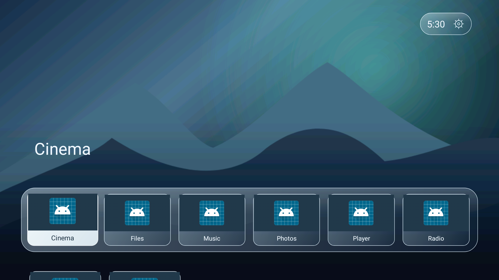
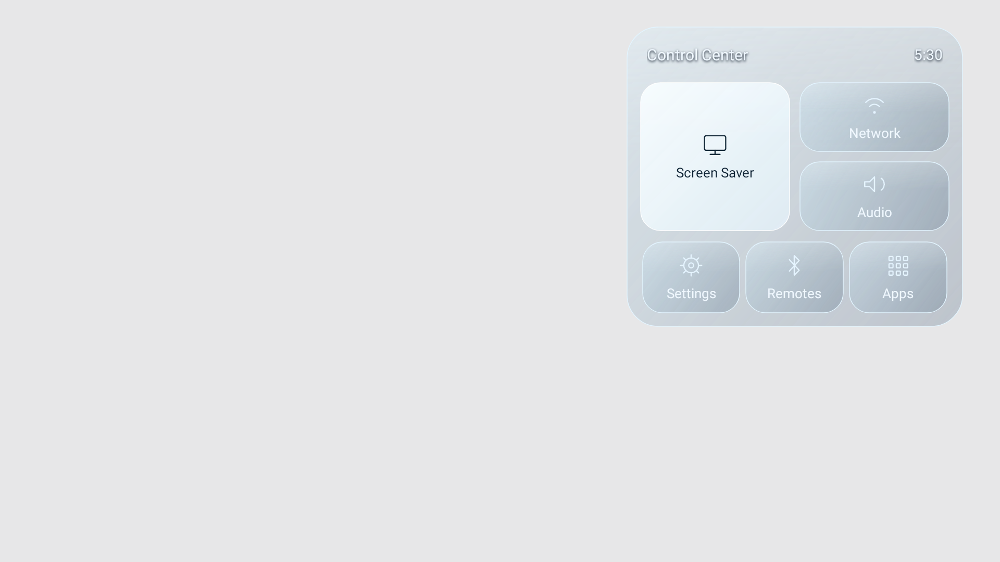

# tvOS

An independent, native Android TV launcher with a floating app dock, original scenery and a translucent glass interface. The app is named **tvOS**; it is an Android launcher, not Apple's operating system or an Apple product.

**1.0.0 community preview · Android 8.0/API 26+ · No production library dependencies**



The screenshots render the actual app views using Android framework simulation at 1920 × 1080. App names in the Home screenshot are test fixtures, not bundled streaming services. Physical-device performance and compatibility testing are still pending.

## Features

- Six-column dock by default, adjustable from four to seven columns; D-pad navigation and app reordering.
- Hold OK on an app to move it earlier/later, place it in the dock or view its information.
- TV Apps and All Apps views, populated from launchable apps installed on the device.
- Floating clock/gear capsule: OK opens Control Center; hold OK opens Settings.
- Layered glass surfaces with a soft sheen, thin edge lighting and three finish strengths. There is no continuous backdrop blur or video loop.
- Original Aurora, Dawn and Night scenery, solid black, or a local photo selected through Android's document picker.
- Home preferences, reduce-motion controls, once-per-boot startup app, clock screen saver and optional inactivity timeout.
- Native network, Wi-Fi, Bluetooth, audio, display, storage and app-information panels. Protected operations have an explicit Android-settings button.



## Install

Download **tvOS-original-preview.apk** from this repository's preview release and open it on your Android TV using a file manager. The file manager may need permission to install APKs. No ADB, root, accessibility helper or stock-launcher removal is required to open the app.

The preview application ID is `com.tvos.launcher.preview`; the public release ID is `com.tvos.launcher`. If updating an earlier preview with a different signing certificate, Android may require uninstalling that preview first. An installation/update is not performed automatically by this repository.

Open **tvOS** in the TV's apps list. Set it as the default Home app through Android's Home-app settings if your manufacturer allows this. Keep the stock launcher installed. To revert, select the previous Home app and uninstall tvOS.

Optional ADB commands:

```sh
adb install -r tvOS-original-preview.apk
adb shell am start -n com.tvos.launcher.preview/com.tvos.launcher.HomeActivity
```

## Device settings and limitations

Wi-Fi scans require location permission and may also need Location enabled. Direct Wi-Fi switching and connection APIs are available only on Android 8/9; newer Android versions use an explicit Android Wi-Fi screen for changes. The app never treats a connection request alone as success. Open/personal PSK networks are supported by the legacy connection flow; unfamiliar, enterprise and other unsupported authentication types use system controls.

Bluetooth discovery/pairing uses Android's public APIs. Nearby-device permission is requested on Android 12+, and older versions use location permission for discovery. Pairing may show an Android confirmation. A paired device is not labeled connected. On Android 13+, radio switching is managed by Android. Missing radios, denied access and fixed-volume audio have fallbacks.

Media volume/mute work when the device allows them. HDMI/receiver volume, surround routing, global language/time, accounts, firmware updates, USB drive management and other privileged controls remain managed by Android. This app cannot override manufacturer restrictions on default launchers or protected settings.

The startup app is opened only after Home first resumes in a new boot, when the device exposes its boot counter. It is not a background boot service. The selected app is not immediately launched when choosing the preference.

New interface text is currently English. Android-provided dialogs follow the system language. Photo access uses the URI chosen by the user; removing a file or revoking access returns the backdrop to the built-in scenery.

## Privacy

There is **no INTERNET permission**, advertising, analytics, cloud account or remote recommendation service. Preferences and app ordering remain local. Wi-Fi/Bluetooth data is used for the visible panels and not uploaded. Local-photo access is user-selected; no broad storage permission is requested. The app requests that Android disable backup. Opening another app transfers control to that app and its policies.

## Build

Use JDK 17, Android SDK platform 34, build-tools 34.0.0 and Python 3. Set `ANDROID_HOME`, or create an untracked `local.properties` with `sdk.dir=/your/Android/sdk`.

```sh
chmod +x gradlew build.sh
./build.sh
```

The build runs unit/framework tests and lint, creates a signed development preview and an unsigned release, and verifies their identities, signatures, permissions and license assets. Artifacts go in `dist/`. The unsigned artifact is not an installable release until signed.

The app is written in Java with Android framework views; there are no third-party runtime libraries or bundled font files. Gradle/AGP are build tools, and JUnit/Robolectric are test-only dependencies. Native graphics renders can be exported by setting `TVOS_RENDER_DIR` to an output directory during the build.

See [release signing](docs/RELEASING.md), [testing](docs/TESTING.md), [source and dependency notes](NOTICE), and [contributing](CONTRIBUTING.md).

## License

MIT; see [LICENSE](LICENSE). The Gradle wrapper retains its own Apache 2.0 notices. App icons and banners shown at runtime belong to the installed apps; this source does not bundle third-party streaming artwork, Apple logos or Apple fonts.
